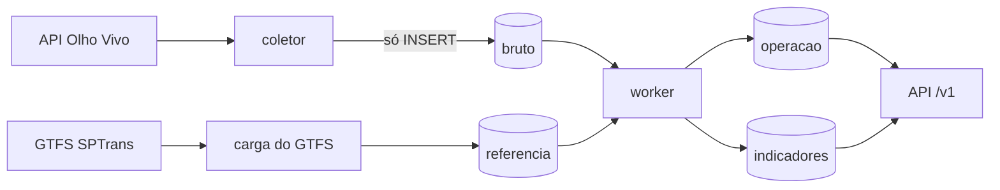

# Modelo do banco

Card T5 · decisões em `docs/adr-001.md` (D3, D6, D7).

PostgreSQL 17 com PostGIS e pg_partman. A imagem fica em `db/Dockerfile`; extensões, schemas e papéis são criados por `db/init/` na primeira subida do volume (`make up`). Tabelas entram por migração Alembic (T6 em diante).

## Camadas

| Schema | Conteúdo | Quem escreve |
|---|---|---|
| `bruto` | posições e respostas da Olho Vivo como chegaram; imutável | coletor (só `INSERT`) |
| `referencia` | GTFS versionado e programação | carga do GTFS |
| `operacao` | viagens reconstruídas e passagens por parada (próximas sprints) | worker |
| `indicadores` | indicadores calculados | worker |
| `partman` | tabelas internas do pg_partman | extensão |

O PostGIS fica no schema `public`.

## Papéis

| Papel | Quem usa | Login |
|---|---|---|
| `POSTGRES_USER` (padrão `onibus_admin`) | migrações e manutenção; dono de todos os objetos | sim |
| `onibus_escrita` | coletor e worker | sim |
| `onibus_leitura` | API | sim |

As senhas vêm do `.env` (`POSTGRES_PASSWORD`, `DB_WRITER_PASSWORD`, `DB_READER_PASSWORD`). A aplicação nunca usa o administrador.

## Permissões

| Schema | `onibus_escrita` | `onibus_leitura` |
|---|---|---|
| `bruto` | `SELECT`, `INSERT` | `SELECT` |
| `referencia` | `SELECT`, `INSERT`, `UPDATE`, `DELETE` | `SELECT` |
| `operacao` | `SELECT`, `INSERT`, `UPDATE`, `DELETE` | `SELECT` |
| `indicadores` | `SELECT`, `INSERT`, `UPDATE`, `DELETE` | `SELECT` |

- Ninguém tem `UPDATE`, `DELETE` ou `TRUNCATE` em `bruto`. Correções geram dados novos em `operacao`.
- Nenhum papel da aplicação tem `CREATE` nos schemas: só o administrador cria tabelas.
- As permissões são `ALTER DEFAULT PRIVILEGES` do administrador: valem para toda tabela que ele criar. **Rode as migrações como o administrador**, senão as tabelas novas nascem sem permissão para a aplicação.
- Conferir no psql: `\dn+` (schemas), `\du` (papéis), `\ddp` (permissões padrão), `\dp bruto.*` (permissões de cada tabela).

## Operação local

- `make up` cria o banco na primeira vez; os dados ficam no volume `onibus_dados_banco`.
- Os scripts de `db/init/` só rodam com o volume vazio. Depois de mudá-los, ou de mudar as senhas do `.env`, rode `make db-reset` (apaga os dados locais).
- Conexão do seu computador: `localhost:${DB_PORT}` (padrão 5432). De dentro do compose: host `db`, porta 5432.
